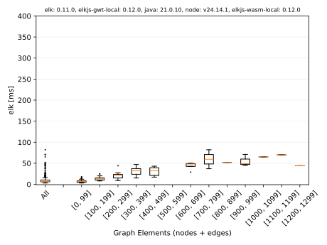
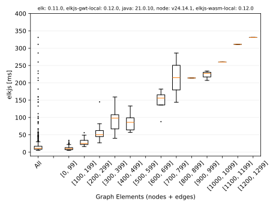
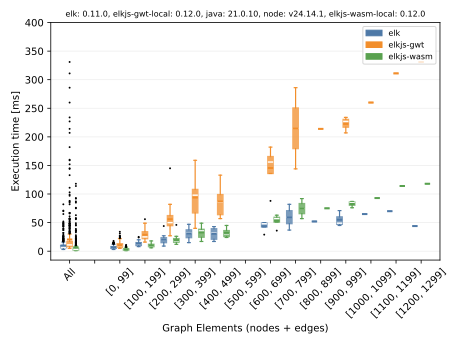
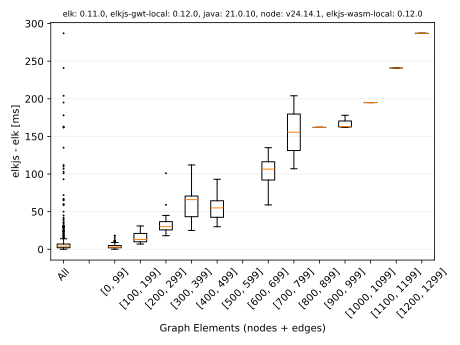
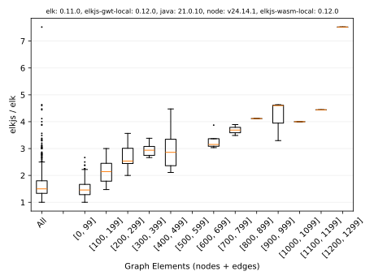
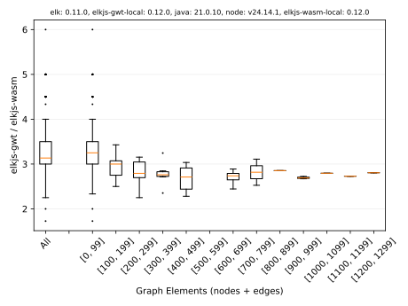
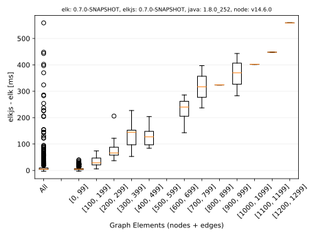
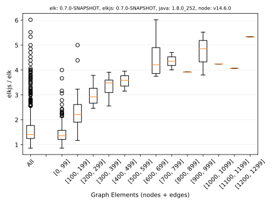

# Execution Time Comparison ELK (Java) vs elkjs

Results shown below are for the Ptolemy models in the [elk-models](https://github.com/eclipse/elk-models) repository. 

Each algorithm was run ten times for each diagram, with the shortest execution time being recorded. An up-to-date laptop has been used, see the result files for further specs. 

## Absolute Execution Times (Core i5-14400)

ELK | elkjs | elkjs-wasm
-|-|-
 |  | |


## Comparison (Core i5-14400)

Numbers larger than 0ms (absolute) or larger than 1.0 (relative) indicate that ELK has been faster than elkjs.

Absolute | Relative | Relative (gwt / wasm)
-|-|-
 |  |  |

## Comparison (Java 8, node.js 14.6, Core i7-8550U)

Absolute | Relative
-|-
 |  |

## Usage

Build:
```
npm install
npm run venv
npm run build
```

Benchmark the published default setup (`elkjs` from `package.json` and ELK from Maven Central):
```
node src/main/js/speed.js ./../elk-models/**/*.json
```

Run `elk-speed` with local builds:
```
ELKJS_LOCAL_ROOT=../elkjs node src/main/js/speed.js ./../elk-models/**/*.json
```

Generate plots from a result file with:
```
source ./.venv/bin/activate
node src/main/js/eval.js ./results/result-202007241256.json
```

### Trouble
```
ModuleNotFoundError: No module named 'tkinter'
sudo apt-get install python3-tk
```
